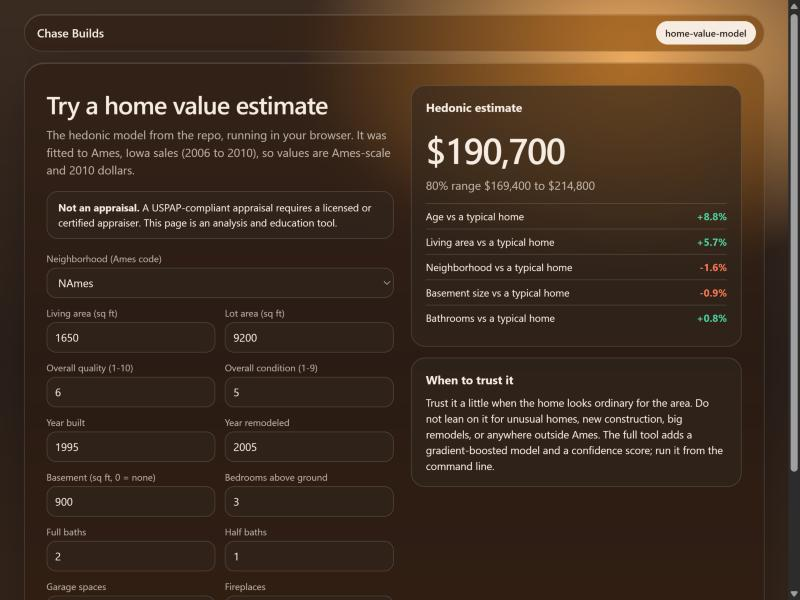

# home-value-model

[](https://github.com/chasebuilds/home-value-model/actions/workflows/ci.yml)
[](LICENSE)

**An automated valuation model (AVM) that tells you how far to trust each number.** Give it a home's basic facts, or a CSV of hundreds, and it returns an estimate, an 80% value range, a 0 to 100 confidence score and plain-English warnings. It is tested on later sales it never saw, using the metrics lenders and assessors use (MdAPE, PPE10, FSD, COD).

**Live demo:** <https://chasebuilds.github.io/home-value-model/> (runs in your browser, nothing is uploaded)



> **Not an appraisal.** This is an analysis and education tool. A USPAP-compliant appraisal requires a licensed or certified appraiser.

**Held-out result on 718 real Ames sales:** median error 6.0%, 72.4% of estimates within 10% of the sale price, against 11.6% and 43.0% for a neighborhood price-per-square-foot rule. Full table and a re-runnable [BENCHMARK.md](BENCHMARK.md) below.

## What it does

- Fits a **hedonic log-price regression** (every coefficient readable) and a **gradient-boosted model** (scikit-learn `HistGradientBoostingRegressor`) on the Ames, Iowa housing sales.
- Trains on sales from 2006 to 2008 and tests on 2009 and 2010 sales it never saw. No random shuffle across time.
- Scores the result with AVM metrics: median absolute % error (MdAPE), PPE10 (share of estimates within 10% of the sale price), forecast standard deviation (FSD), plus COD and PRD.
- Gives each estimate a **confidence score (0 to 100)**, a plain-English band (low, medium, high), an 80% value range, and warnings.
- Explains the model with permutation feature importance and per-home price drivers.

## Quick start

```powershell
py -m venv .venv
.venv\Scripts\python -m pip install -e ".[dev]"
.venv\Scripts\avm train --source ames --report results.json   # downloads Ames to your cache
.venv\Scripts\avm predict examples/subject.json
```

Without network, use the seeded synthetic set instead: `avm train --source synthetic`.

Example output (`avm predict examples/subject.json`, model refit on all 2006 to 2010 sales):

```
Estimate: $188,200   (80% range $172,600 to $205,300)
Hedonic model alone: $190,700
Confidence: 91/100 (high)
Biggest price drivers vs a typical home (hedonic model):
  age                    +8.8%
  living area            +5.7%
  neighborhood           -1.6%
  ...
```

`avm predict` also takes `--json`.

### Value a whole list, and print a one-page report

```powershell
.venv\Scriptsvm batch examples/subjects.csv --out estimates.csv
.venv\Scriptsvm report examples/subject.json --out report.html
```

`avm batch` values every row of a CSV. Bad rows do not stop the run: they are skipped and listed with a reason in `estimates_skipped.csv` (non-numeric or out-of-range inputs, blank fields). Fixable oddities are repaired and noted in a `notes` column: a blank remodel year means "never remodeled", and a remodel year before the build year is replaced with the build year. Headers are matched loosely (`Gr Liv Area` works), and an optional `valuation_year` column sets the age basis per row. [examples/subjects.csv](examples/subjects.csv) is a small made-up file with four deliberate problems. `avm report` writes a standalone HTML page (no scripts, prints cleanly) with the estimate, range, confidence, warnings, drivers and the disclaimer. The subject file lists 12 numeric fields and a neighborhood (see [examples/subject.json](examples/subject.json)); `valuation_year` is optional and sets the age basis.

## Model card

**Data.** Ames, Iowa Assessor's Office residential sales, 2006 to 2010, as published by Dean De Cock, "Ames, Iowa: Alternative to the Boston Housing Data Set", *Journal of Statistics Education* 19(3), 2011 ([paper](https://jse.amstat.org/v19n3/decock.pdf), [data](https://jse.amstat.org/v19n3/decock/AmesHousing.txt)). I could not find a license that clearly allows redistribution, so **the data is not in this repo**: `avm train --source ames` downloads it to your user cache at run time. The parcel ID column is dropped on load. Following the author's advice, only normal-condition single-family sales under 4,000 sq ft of living area are kept: 2,001 sales (1,283 train, 718 test).

**Inputs (13).** Living area, lot area, overall quality, overall condition, year built, year remodeled, basement area, full and half baths, bedrooms, garage spaces, fireplaces, neighborhood.

**Split.** Train: sales in 2006 to 2008. Test: sales in 2009 and 2010. The confidence layer and ranges are built only from out-of-fold errors inside the training years.

**Results on the 718 held-out 2009 to 2010 sales** (reproduce with `avm train --source ames --report results.json`; the full output is in [docs/results_ames.json](docs/results_ames.json)):

| Model | MdAPE | PPE10 | PPE5 | FSD | COD | Median ratio |
|---|---|---|---|---|---|---|
| Rule of thumb (neighborhood median $/sq ft) | 11.6% | 43.0% | 21.4% | 0.199 | 15.9 | 0.986 |
| Hedonic (log-price ridge) | 6.2% | 72.3% | 42.6% | 0.106 | 8.1 | 0.989 |
| Gradient boosting | 6.0% | 72.4% | 43.2% | 0.108 | 8.0 | 0.988 |
| Average of the two (log scale) | 5.6% | 75.5% | 44.8% | 0.100 | 7.6 | 0.986 |

- The two models are about equally accurate here. Boosting is not clearly better than the linear model on 1,283 training homes.
- The default estimate in the CLI is the gradient-boosted one. The average of the two scored best on test, but I picked the default before seeing the test numbers, so I report the average and did not switch to it.
- Median ratio is estimate / sale price: both models run about 1% low on later sales. The 2008 to 2010 market moved, and the models do not know the calendar year.
- FSD here is the standard deviation of sale price / estimate.

**Confidence score.** A small error model predicts how wrong the estimate is likely to be for this home, using the home's features and how far the two models disagree. Homes outside the central 98% of training values, or in an unseen neighborhood, are pushed lower. The score is the share of training homes that looked riskier, so 80 means "safer than about 80% of training homes". Bands: high 67 and up, medium 33 to 66, low under 33. Held-out check, using the gradient-boosted estimate:

| Confidence band | Test homes | MdAPE | PPE10 | Sale inside 80% range |
|---|---|---|---|---|
| high | 213 | 4.8% | 86.4% | 76.5% |
| medium | 221 | 5.8% | 73.8% | 78.7% |
| low | 284 | 7.7% | 61.6% | 82.0% |
| all | 718 | 6.0% | 72.4% | 79.4% (target 80%) |

The score does what it should: higher bands were more accurate on later sales. The ranges are close to their 80% target overall, a little too narrow for the high band.

**What drives the estimate.** Permutation importance on the test sales (rise in MdAPE, in percentage points, when one input is shuffled):

| Input | Gradient boosting | Hedonic |
|---|---|---|
| Living area | +6.4 | +8.3 |
| Overall quality | +3.4 | +3.8 |
| Year built | +3.0 | +6.0 |
| Basement area | +1.9 | +1.2 |
| Overall condition | +1.3 | +2.6 |
| Neighborhood | +0.9 | +1.4 |

Everything else was under one point. Hedonic coefficients are in [docs/model.json](docs/model.json) (log-price per unit; for example the living-area elasticity is about 0.42).

## When to trust an estimate, in plain English

**Trust it more when** the home is ordinary for its area: typical size, age and quality, in a neighborhood the model has seen many sales from, and the two models land within a few percent of each other. Confidence is "high" and there are no warnings.

**Trust it less, or not at all, when:**
- the home is unusual (very large, very old, no basement, luxury finishes, odd layout);
- the model warns the neighborhood was never seen or an input is outside the usual range;
- the two models disagree by more than 15%;
- the market has moved since 2010 (it has; this model only knows 2006 to 2010 Ames);
- condition matters a lot and the data cannot see it (a gutted kitchen, a failing roof, a recent remodel not reflected in year remodeled);
- the home is outside Ames, Iowa. Do not use these prices anywhere else.

An estimate is a starting point for a human who knows the market. It never replaces comparable sales, an inspection or an appraisal. See [LIMITATIONS.md](LIMITATIONS.md).

## Layout

```
src/home_value_model/   data.py features.py model.py metrics.py report.py batch.py cli.py
scripts/benchmark.py    regenerates BENCHMARK.md from measured runs
tests/                  34 tests (metrics, split, models, confidence, CLI, loader, batch, report)
data/sample_synthetic.csv   600 seeded fake homes, used by tests and CI (no network)
docs/                   demo page, hedonic coefficients, saved results, screenshot
examples/subject.json   a sample subject property
```

## Development

CI runs ruff, mypy (strict) and pytest on Python 3.11 and 3.13. It uses only the committed synthetic sample, so it never touches the network.

```powershell
.venv\Scripts\python -m ruff check .
.venv\Scripts\python -m mypy
.venv\Scripts\python -m pytest
```

The synthetic data (`avm synth --n 600 --seed 0`) comes from a made-up price formula with noise. It exists to test the code, not to say anything about real prices.

## License

MIT, see [LICENSE](LICENSE). The Ames data is not included and keeps its own terms; cite De Cock (2011) if you use it.

Built by Chase Builds.

## More from Chase Builds

- **[listing-data-normalizer](https://github.com/chasebuilds/listing-data-normalizer)**: Turns messy MLS and county exports into one clean table, with duplicates merged and price history kept. ([live demo](https://chasebuilds.github.io/listing-data-normalizer/))
- **[income-approach-valuation](https://github.com/chasebuilds/income-approach-valuation)**: Income approach for rentals and small commercial: rent roll to NOI, direct cap, band of investment and DCF, reconciled. ([live demo](https://chasebuilds.github.io/income-approach-valuation/))
- **[showing-route-planner](https://github.com/chasebuilds/showing-route-planner)**: Orders a day of showings around every listing window with the least driving. Works offline on a phone. ([live demo](https://chasebuilds.github.io/showing-route-planner/))

[All projects, sorted by industry](https://github.com/chasebuilds) · [chasebuilds.github.io](https://chasebuilds.github.io)
